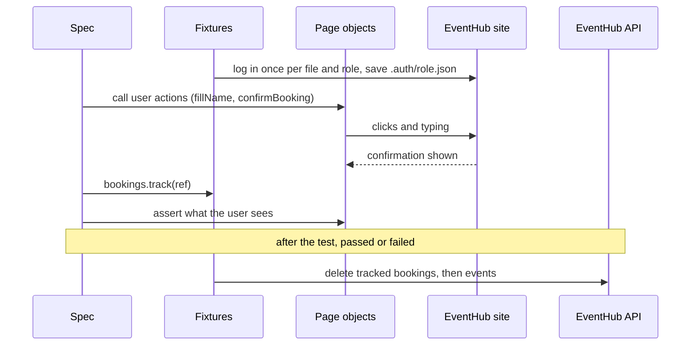
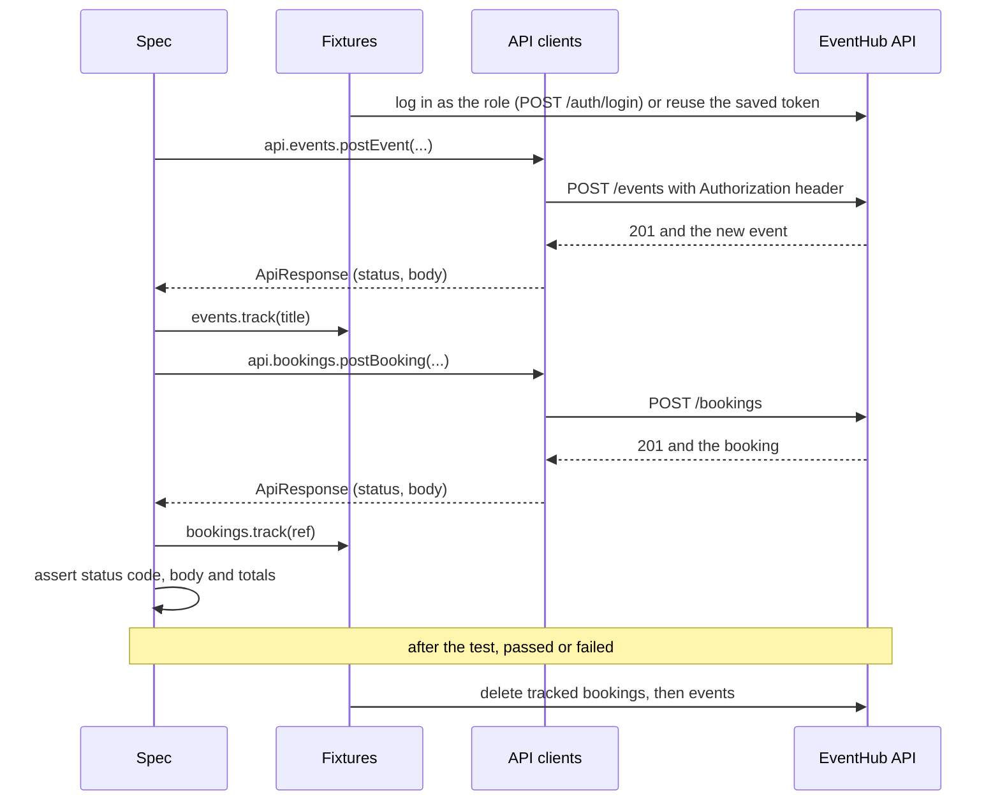
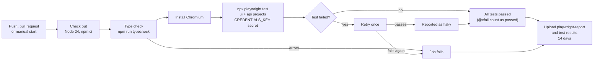

# EventHub QA Automation

Playwright + TypeScript UI and API automation for story **US-114 "Book tickets for an event"** (AC1-AC5) on https://eventhub.rahulshettyacademy.com.

> **Read first:** where the story or the app was unclear, I made [assumptions](#8-assumptions) and listed them in one place. Expected results that depend on them are marked as such in the defects and the tests.

| | |
| --- | --- |
| **Tests** | 101 in 30 files (58 UI, 43 API; 2 are expected failures, see below), plus 8 setup and teardown steps |
| **Stack** | Playwright Test, TypeScript (strict), GitHub Actions |
| **Accounts** | 4 test accounts, one per parallel worker |
| **Found** | 7 defects and observations (2 with tests), 3 documentation mismatches, 9 other findings, 21 questions for the Product Owner |

**Contents:** [Quick start](#quick-start) · [1. Story review](#1-story-review) · [2. Defects and observations](#2-defects-and-observations) · [3. Test strategy](#3-test-strategy-what-is-covered-and-why) · [4. Framework architecture](#4-framework-architecture) · [5. Key decisions](#5-key-decisions) · [6. Continuous integration](#6-continuous-integration) · [7. What I would do with more time](#7-what-i-would-do-with-more-time) · [8. Assumptions (read first)](#8-assumptions) · [9. How AI was used](#9-how-ai-was-used)

## What the assessment asked for, and where to find it

| The assessment asks for | Where it is answered |
| --- | --- |
| How to run the tests and the credentials needed | [Quick start](#quick-start) and [Credentials for reviewers](#credentials-for-reviewers) |
| A review of the story: what is missing, unclear or wrong, and what to ask the Product Owner | [1. Story review](#1-story-review) and [Questions for the Product Owner](#questions-for-the-product-owner) |
| Anything in the app that does not match the story or the docs | [2. Defects and observations](#2-defects-and-observations) |
| UI and API automation of the booking flow (AC1 to AC5) | [Coverage by acceptance criterion](#coverage-by-acceptance-criterion) |
| An architecture that can grow over a couple of years | [Scalability](#scalability), [The layers](#the-layers-from-the-top) and [Structure](#structure) |
| Authorization handled by the framework, not by tests | [5. Key decisions](#5-key-decisions), decision 2 |
| Why these tests and not others | [Test strategy](#3-test-strategy-what-is-covered-and-why) |
| Cleaning up data on a shared environment | [5. Key decisions](#5-key-decisions), decision 4 |
| Bonus: GitHub Actions on every push | [6. Continuous integration](#6-continuous-integration) |
| Key decisions and what I would do with more time | [5. Key decisions](#5-key-decisions) and [7. What I would do with more time](#7-what-i-would-do-with-more-time) |
| Assumptions where something was unclear | [8. Assumptions](#8-assumptions) |
| AI tools: be ready to explain what was submitted | [How AI was used](#9-how-ai-was-used) |

## Quick start

```powershell
npm ci
npx playwright install chromium
$env:CREDENTIALS_KEY="<passphrase>"   # decrypts the passwords in data/testcredentials.json (or put CREDENTIALS_KEY=... in .env)
npm test                          # everything (ui + api)
npm run test:ui                   # ui project only
npm run test:api                  # api project only
npm run test:xfail                # only the expected failures (known defects)
npm run typecheck
npm run lint                        # ESLint (typescript-eslint and the Playwright plugin)
npm run lint:fix                   # same, and fixes what can be fixed
npm run verify                     # typecheck + lint, run this before a commit
npm run report                    # open the HTML report
```

Optional `.env`: `BASE_URL`, `API_BASE_URL`, `HEADLESS=false`, `SLOW_MO=500` (watch the flow locally).

**Windows PowerShell 5.1:** the console may print `Γ£ô` instead of the check mark in the test list. That is only the console encoding; run `[Console]::OutputEncoding = [System.Text.Encoding]::UTF8` once per session (or use Windows Terminal or PowerShell 7).

**Credentials.** Four throwaway test accounts on the public EventHub site (roles `primaryUser`, `secondaryUser`, `thirdUser`, `fourthUser`) are in [data/testcredentials.json](data/testcredentials.json). The emails are readable; each password is encrypted as `<iv>:<data>:<tag>` (AES-256-GCM, key derived from a passphrase). The passphrase is shared separately, not in the repository.

- **Run the tests:** set the passphrase, then run as usual. The framework decrypts the passwords in memory.
  ```powershell
  $env:CREDENTIALS_KEY="<passphrase>"
  npm test
  ```
- **Decrypt a password** to see it:
  ```powershell
  npm run credentials:decrypt -- "<iv>:<data>:<tag>"
  ```
- **Encrypt a new password** and paste the printed value into the JSON:
  ```powershell
  npm run credentials:encrypt -- "MyPassword1."
  ```
  A password written as plain text also works, and needs no passphrase.
- **CI:** add the passphrase as the repository secret `CREDENTIALS_KEY`.

**Parallel runs.** Each worker runs as its own account (worker 0 = `primaryUser`, worker 1 = `secondaryUser`, ...), so the default is 4 workers, one per account. Use `$env:WORKERS=1` for a serial run. Do not run the `ui` and `api` projects in two terminals at the same time, because they would share the accounts. Tests inside one spec file always run in order. A failed test is retried once; a test that passes on the retry is reported as flaky.

**Expected failures.** Two tests document product defects and are marked `test.fail(...)` with the `@xfail` tag. The report shows them as passed (they fail as expected), so a normal run is green. If one of them starts to really pass, Playwright reports it as a failure, which means the bug was fixed and the marker can be removed. List them with `npm run test:xfail` (or `npx playwright test --grep "@xfail"`; quote it in PowerShell). Each one carries its reason in the report: the HTML report shows a `fail` annotation with the defect description on the test. They are:

| Defect | Test |
| --- | --- |
| 2 Decimal price rounded in the UI | `tests/ui/edgecases/decimalPriceEvent.spec.ts` (1 test) |
| 3 Fractional seat count (1.5) accepted by the event form | `tests/ui/edgecases/eventFormValidation.spec.ts` (1 test) |

**Tags.** `@ui`, `@api`, `@booking`, `@admin`, `@events`, `@edge`/`@edgecase`, `@negative`, `@security`, `@xfail`, `@seeded` (tests that use only the seeded events, see decision 13). For example `npx playwright test --grep @security`.

### Credentials for reviewers

The task says to provide the credentials needed to run the tests. The emails are in the repository; the passwords are encrypted in `data/testcredentials.json`. The passphrase for the reviewers is `CREDENTIALS_KEY=xuYoZQnN0y0LRtRqJs7KvjQYvGttVo`. A reviewer needs only that one value, as an environment variable or in a `.env` file, to run everything. Reviewers may also replace the accounts with their own: register on the site and put the email and password (plain text works too) in `data/testcredentials.json`.

A Playwright setup project (`tests/setup/auth.setup.ts`) logs every role in once before the tests. After the `ui` and `api` projects finish, a teardown project (`tests/setup/cleanup.teardown.ts`) deletes bookings and events older than 30 minutes from the test accounts, which are leftovers of aborted runs, and records the count as an annotation in the report. `npm run cleanup` removes everything on the accounts, regardless of age.

In CI ([.github/workflows/playwright.yml](.github/workflows/playwright.yml)) the encrypted passwords are decrypted with the `CREDENTIALS_KEY` secret. The HTML report is uploaded as an artifact.

## 1. Story review

Test cases docs are in [docs/test-cases/ui](docs/test-cases/ui) and [docs/test-cases/api](docs/test-cases/api).

### What is wrong, missing or unclear in US-114

| Area | What is wrong, missing or unclear |
| --- | --- |
| Actor | **S-01** the story says "visitor", but booking needs a logged-in user (anonymous: login page, API 401). Tests log in; the visitor case is only "must sign in". |
| AC1 | **S-02** no ticket limits or message when seats run out (tests use 1 to 10 and the seats left). **S-03** no rules for name, email, phone. **S-04** reference format unspecified: Swagger shows `EVT-A1B2C3`, the app `D-J7DJEU` (tests accept `/^[A-Z0-9]+-[A-Z0-9]{6}$/`). **S-05** nothing on seats after booking or cancel, or on past and sold-out events (defect 1). **S-11** whose details are entered, and no confirmation email. |
| AC2 | **S-06** nothing on currency, rounding, decimal prices, taxes, fees or free events (decimal price is defect 2; free events pass). |
| AC3 | **S-07** no fields or order for My Bookings (tests check title, tickets, total, reference). |
| AC4 | **S-08** "cancel" is not defined. In the app, cancel means the booking is deleted (`GET` returns 404 afterwards), not marked as cancelled, and the seats return. Also no rules on who can cancel, until when, or refund. |
| AC5 | **S-09** only "the same works through the API": no auth, request or response shape, error codes, double submit (tests check 201, 400, 401, 403, 404). |
| Whole story | **S-10** no non-functional criteria: duplicate bookings (tested as current behaviour), last-seat race and accessibility (not covered). **S-12** no payment, though the details page has a payment block (a booking counts as confirmed without it). |

### Suggested rewrite of the story

A version the team could test without guessing (every sentence maps to a question in the table below):

> **As a** registered, logged-in user **I want to** book 1 to 10 tickets for an upcoming event **so that** I can attend it.
> - AC1: With a quantity between 1 and the seats left (maximum 10), a valid name, email and phone, **Confirm Booking** creates a booking and shows a confirmation with a unique booking reference.
> - AC2: The total is the price per ticket multiplied by the quantity, shown with cents.
> - AC3: The booking is listed in My Bookings with event, date, quantity, total and reference, and the event's available seats are reduced.
> - AC4: The owner can cancel a booking until `<deadline>`; the seats are released and the booking is removed (or marked cancelled).
> - AC5: `POST /api/bookings` with the same rules returns 201 with the booking, 400 for invalid input, 401 without a token, 404 for an unknown event, and nothing is created on an error.
> - Out of scope or to decide: past and sold-out events, duplicate bookings, refunds.

### Questions for the Product Owner

| # | Topic | Question and why it matters |
| --- | --- | --- |
| Q-01 | Guests | Should a visitor be able to book without an account, or should the story say "registered user"? **Why it matters:** Decides the actor and whether guest booking needs tests. |
| Q-02 | Limits | What are the ticket limits, and what message is shown when seats run out? Is the maximum of 10 per booking, per user or per event? A user can book the same event several times today, so 10 per booking is not a limit per user (see O-3). **Why it matters:** The tests use 1 to 10 per booking and the seats left. |
| Q-03 | Validation | What is valid for name, email and phone (format, length, country code, required or optional), and what are the exact error messages? Are international numbers (for example +49 ...) valid? Should the UI and the API apply the same phone rule? **Why it matters:** The tests encode the rules the app enforces. |
| Q-04 | Booking reference | Which format is correct, the Swagger example `EVT-A1B2C3` or a short prefix such as `D-J7DJEU`? The prefix follows the first letter of the event title; is that intended? Is the reference unique and permanent? **Why it matters:** The tests accept both shapes. |
| Q-05 | Past and sold-out events | Should a past or sold-out event be bookable? If not, should the Book button be disabled, or should the API return an error (and which status)? **Why it matters:** Defect 1: today a past event can be booked. |
| Q-06 | Decimal prices | Should the UI show cents ($12.35 and a total of $37.05), or are whole dollars intended? Which currency (the placeholder phone is `+91 ...`, an Indian number, yet prices are shown in `$`), and are there fees or taxes? **Why it matters:** Defect 2: the backend stores the exact value, the UI rounds. |
| Q-07 | Free events | Can an event cost 0? Should it have a different flow (for example no payment step)? **Why it matters:** Today a free event can be created and booked, the total is 0. |
| Q-08 | My Bookings | Which fields must My Bookings show, in what order, and is the list paged (how many per page)? **Why it matters:** Defines what AC3 checks. |
| Q-09 | Cancellation | Is there a deadline or a refund? Can part of a booking be cancelled? Is a cancelled booking deleted or kept with a "cancelled" status, and are the seats released? **Why it matters:** Today the booking is deleted (`GET` returns 404 afterwards) and the seats return. |
| Q-10 | API | What are the required fields, status codes and error format for `POST /bookings`? Which of AC1 to AC4 must also hold through the API? **Why it matters:** Defines what AC5 checks. |
| Q-11 | Duplicates and concurrency | May one user book the same event more than once? What protects against a double submit? What should happen when two users book the last seat? **Why it matters:** Today duplicates are allowed in the UI and the API. The double submit and the last-seat race are not tested. |
| Q-12 | City filter | Should "Los Angeles" be a filter option, or should the demo concert use a city that the filter offers? **Why it matters:** Defect 4: that event cannot be found by city. |
| Q-13 | Seat count | Should the event form reject 1.5 seats like it does 0 and -5? **Why it matters:** Defect 3: no error is shown. |
| Q-14 | Edit and delete | Should deleting an event delete its bookings silently? Should an edit change how existing bookings look? **Why it matters:** Both happen today (`deleteBookedEvent`, `editBookedEvent`). |
| Q-15 | Booking for someone else | May a user book on behalf of someone else? Should the form be pre-filled from the profile? Is a confirmation email expected? **Why it matters:** Name, email and phone are free text today and no email is checked. |
| Q-16 | Payment | Is payment out of scope for this story? Is a booking "confirmed" without payment? **Why it matters:** The details page has a payment block, but there is no payment step. |
| Q-17 | Non-functional | Are there accessibility, mobile or performance criteria for booking? **Why it matters:** Not covered today (see "What I would do with more time"). |
| Q-18 | Seat counter | Should the seat count on the event page update right after a booking? **Why it matters:** Tests read seat counts after a reload. |
| Q-19 | Quantity type | Should the API reject a quantity sent as a string? **Why it matters:** Not tested. |
| Q-20 | Clear all bookings | Should the button be hidden or disabled when there are no bookings? **Why it matters:** Not tested. |
| Q-21 | Access control | Why does the API answer 403 in one case and 404 in another? Reading another user's booking by id or reference gives 403, cancelling it gives 404, and booking an event that another user created gives 404 (as if it did not exist). Should all three answer the same, and which one (404 so the API does not reveal that the resource exists, or 403)? **Why it matters:** The tests assert exactly 403 on the reads and 404 on the cancel and on the foreign event, so they must change if the rule changes. |

## 2. Defects and observations

The requirements do not say what is correct for defects 2 and 3, so their tests are marked as expected failures (`test.fail(...)` and the `@xfail` tag). The pipeline stays green, the defects stay visible in the report, and a test turns red when its bug is fixed. That is the signal to remove the marker. Run them with `npm run test:xfail`. Defects 1 and 4 to 7 are observations without a test. Severity is my proposal; the Product Owner decides.

| # | Severity | Finding | Reproduced by |
| --- | --- | --- | --- |
| 1 | High | **Past events can be booked.** (UI and API) Open an event dated in the past (World Tech Summit, 18 Apr 2026) and book it, or `POST /bookings` for it. Expected: Booking is blocked (button disabled or an error). Actual: Booking is confirmed. Question: Q-05. | Observation, no test (see [the note below](#why-there-is-no-test-for-booking-a-past-event)). Creating a past event is refused: `tests/api/events/createPastEvent.spec.ts` (passes) and the date rule in `tests/ui/edgecases/eventFormValidation.spec.ts` (passes). |
| 2 | Medium | **Decimal prices are rounded in the UI.** (UI only) As admin, create an event with price 12.35 and book 3 tickets. Expected: Price $12.35 and total $37.05 (AC2). Actual: UI shows $12 and a rounded total. The API returns `"12.35"` and `totalPrice` 37.05, so only the UI is wrong. Question: Q-06. | Expected failure (`@xfail`): `tests/ui/edgecases/decimalPriceEvent.spec.ts` (1 test). The API check `tests/api/events/eventPrices.spec.ts` passes. |
| 3 | Low | **The event form accepts a fractional seat count.** (UI) As admin, open "+ New Event", fill the other fields and enter 1.5 in Total Seats. Expected: An inline error, like for 0 or -5. Actual: No inline error is shown. Question: Q-13. | Expected failure (`@xfail`): `tests/ui/edgecases/eventFormValidation.spec.ts` (1 test). |
| 4 | Low | **A featured event has a city the city filter does not offer.** (UI) On the Events page, the demo concert is in "Los Angeles", which is not in the city filter. Expected: Every event can be found with the city filter. Actual: That event cannot be found by city. Question: Q-12. | Observation, no test. |
| 5 | Low | **The seat counter on the event page is not updated after booking.** (UI) Open your own event (20 / 20 seats), book 1 ticket and stay on the page. Expected: The counter shows 19 / 20 seats. Actual: It still shows 20 / 20 until the page is reloaded (then 19 / 20). The booking itself is correct. Question: Q-18. | Observation, no test. |
| 6 | Low | **"Clear all bookings" is shown and enabled when there are no bookings.** (UI and API) Open My Bookings with no bookings. `DELETE /bookings` also answers 200 with "0 booking(s) cleared". Expected: The button is hidden or disabled. Actual: The button is enabled next to the "No bookings yet" message. Question: Q-20. | Observation, no test. |
| 7 | Low | **The API accepts the ticket quantity as a string.** (API) `POST /bookings` with `"quantity": "2"` instead of `2`. Expected: 400 validation error for a wrong type. Actual: 201, the booking is created. Question: Q-19. | Observation, no test. |

### Why there is no test for booking a past event

While exploring the app I noticed that all the seeded events are dated in the past, and that they can still be booked. To find out whether this is only demo data or a real defect, I tried to create a new event with a past date and book it. The result:

- The admin form refuses the date ("Must be a future date") and `POST /events` answers 400, so a past event cannot be created in the UI or the API (`tests/api/events/createPastEvent.spec.ts` and the date rule in `tests/ui/edgecases/eventFormValidation.spec.ts`, both pass).
- Because of that, the system itself treats a past date as invalid for events. This suggests that booking the seeded past events is a gap of the demo data and not a deliberate rule, but only the Product Owner can confirm it (Q-05).
- There is no way to create test data for a past event, so a booking test for it would depend on the three seeded events, which are shared and can change. I therefore deleted the earlier `bookPastEvent` tests (UI and API, one of them an expected failure) and keep this as an observation, not as a test.

### Checked and working as expected

- A booking belongs to its owner: another account gets 403 when it reads it and 404 when it cancels it (`tests/api/edgecases/bookingOwnership.spec.ts`).
- A visitor who is not logged in is redirected to the login page when opening My Bookings (`tests/ui/edgecases/anonymousAccess.spec.ts`).
- A free event (price 0) can be created and booked in the UI and the API, and the total is 0.

### Documentation does not match the API

| # | Swagger shows | The app does | Effect on the tests |
| --- | --- | --- | --- |
| D-1 | An "Authorize" button for a bearer token | The token is attached only to `/auth/me`. Every other endpoint is called without it and answers 401. Workaround: add the `Authorization: Bearer <token>` header by hand. | The tests always send the header themselves. |
| D-2 | `bookingRef` example `EVT-A1B2C3` (in `POST /bookings` and `GET /bookings/{id}`) | References start with a different prefix, for example `D-J7DJEU` in the UI. The prefix is the first letter of the event title (an event called "Zeta probe" gave `Z-...`, one called "QA-AUTO probe" gave `Q-...`). | The tests accept letters or digits, a dash and 6 letters or digits (`/^[A-Z0-9]+-[A-Z0-9]{6}$/`). |
| D-3 | Pre-filled sample values in the `GET /events` "Try it out" form (category, city, search) | They match nothing, so the result is an empty list. Clear those fields first. | None. |

### Other findings from exploring the app and API

| # | Finding | Evidence |
| --- | --- | --- |
| O-1 | Deleting an event also deletes its bookings. Customers who booked it lose their bookings silently. May be intended. | `tests/api/events/deleteBookedEvent.spec.ts` |
| O-2 | Editing an event changes how its bookings look: a booking shows the event's current title, city and price. | `tests/api/events/editBookedEvent.spec.ts` |
| O-3 | One user can book the same event more than once. Each booking gets its own reference and takes its own seats. The tests describe the current behaviour and would change if duplicates are forbidden. | `tests/api/edgecases/bookSameEventTwice.spec.ts`, `tests/ui/edgecases/bookSameEventTwice.spec.ts` |
| O-4 | The API returns `price` and `totalPrice` as strings (for example `"12.35"`). | `tests/api/events/eventPrices.spec.ts` |
| O-5 | The live site has only 3 events and all are in the past, so booking tests create their own events where they need known data. | Seeded events (`isStatic`) |
| O-6 | A booking belongs to its owner: another account gets 403 when it reads it, and 404 when it cancels it. | `tests/api/edgecases/bookingOwnership.spec.ts` |
| O-7 | Reading another user's booking (`GET /bookings/{id}` and `/bookings/ref/{ref}`) answers 403, but cancelling it answers 404. The 403 confirms that the booking exists. | Checked on the live API with two accounts. `bookingOwnership` asserts exactly 403 on the reads and 404 on the cancel. |
| O-8 | A booking in the UI has a "Check eligibility for refund?" button on its details page, but the story has no refund rule. | Booking details page |
| O-9 | The event page shows the date without a year ("Monday, 14 December"), the booking details page shows it with the year. | Event page and booking details page |
| O-10 | Testability: the `id` attributes `event-card` and `book-now-btn` are repeated on every card of the Events page (checked on the live site: 3 cards, 3 equal ids), which is invalid HTML. Locators cannot rely on them, so the tests use `data-testid` and roles. | Events page |
| O-11 | Testability: the booking confirmation panel has no `data-testid`, so it is found by its "Booking Confirmed" heading and the `.booking-ref` class. A text or style change breaks those locators; one test id would remove the risk. | `data/selectorAlias/EventDetailsPage.ts` | None |

## 3. Test strategy: what is covered and why

**Approach:** risk-based, following the test pyramid. Every acceptance criterion has a UI test and an API test (AC5 asks for the API). The **API** carries the boundary and negative cases because they are fast, exact and stable there. The **UI** covers only what needs a browser: the user journey, what the customer sees (confirmation, totals, My Bookings), the dialogs and the client-side form rules. The API validation matrix is not repeated in the browser. When a rule is checked in both, the pair shows where a bug is: for the decimal price the API test passes and the UI test fails, so the front end is wrong.

The highest risks in a booking flow are **money** (wrong totals), **inventory** (seats), **access control** (other people's bookings) and **data integrity** (what the screen shows matches what is stored). Every test maps to one of these risks or to an acceptance criterion.

### API: `tests/api/`

| File | Covers | Why |
| --- | --- | --- |
| `booking/createBooking` | AC1, AC2, AC3, AC5: one test books 2 tickets on every listed event. Status "confirmed", reference format, `totalPrice` = price x quantity, seats go down, booking found in the list and by reference | Core contract and money, checked on all seeded data |
| `cancellation/cancelBooking` | AC4: cancel returns 200, seats are restored, the booking is gone from the list, `GET` returns 404, cancelling twice returns 404 | Inventory after cancel. Cancel means delete, not "marked as cancelled" |
| `cancellation/cancelOneOfTwoBookings` | Only the cancelled booking's seats are released, the other stays confirmed | Catches releasing too many seats |
| `edgecases/createBookingValidation` | Missing field, quantity 0, -1, 2.5 and 11, bad name, email and phone, no token (401), sold-out event, more tickets than seats; each case checks that no seats were taken | Boundary values. "No side effects" protects inventory |
| `edgecases/bookingOwnership` | The owner reads the booking by id, by reference and in the list; another account gets 403 on the reads, 404 on the cancel and does not see it in its list | Access control, run as two different users |
| `edgecases/bookOthersEvent` | Booking an event created by another account returns 404 and takes no seats | Access control on events |
| `edgecases/bookSameEventTwice` | Two bookings of one event: different ids and references, seats reduced by both | Documents the current behaviour (Q-11) |
| `edgecases/createEventValidation` | Missing fields, bad titles, negative price on `POST /events` | Booking tests rely on events made by the suite |
| `events/bookNewEvent`, `editBookedEvent`, `deleteBookedEvent` | A new event can be booked; an edit shows in its bookings; a delete removes its bookings | Data integrity between events and bookings |
| `events/eventPrices` | Decimal price keeps the exact value and total (12.35, 37.05); a free event books with total 0 | Money. Proves the backend is right when the UI rounds (defect 2) |
| `events/createPastEvent` | A past event date is refused with 400 | The rule that booking a past event breaks (defect 1) |

### UI: `tests/ui/`

| File | Covers | Why |
| --- | --- | --- |
| `booking/bookFeaturedEventTicket`, `bookFromEventsPage` | The journey from Home and from the Events page: choose the event, fill name, email and phone, Confirm Booking, check the confirmation (reference, customer, tickets, total) (AC1) | The primary user journey |
| `booking/bookMultipleTickets` | 2, 4 and 10 tickets: summary line, total, confirmation, seats before and after, and the card in My Bookings (AC2, AC3) | What the customer sees about money and seats |
| `booking/verifyBookingDetails` | The booking details page: header, customer and payment blocks | The page a customer opens from My Bookings |
| `cancellation/cancelFeaturedEventBooking`, `cancelFromBookingDetails` | Cancel through the dialog: dismiss keeps the booking, confirm removes it and the seats return (AC4) | Destructive action protected by a confirmation step |
| `cancellation/clearAllBookings` | Three bookings are cleared together and stay gone after a reload | Bulk delete |
| `edgecases/bookingFormValidation` | Form content, empty form (three errors), bad name, email and phone rejected, valid form accepted | Rules that exist in the browser |
| `edgecases/ticketQuantity` | Starts at 1, cannot go below 1, stops at 10 and at the seats left; the total follows the quantity | Limits of the stepper |
| `edgecases/anonymousAccess` | A visitor opening My Bookings or an event page is sent to the login page | Story says "visitor" (S-01) |
| `edgecases/bookSameEventTwice`, `freeEvent` | Two bookings of one event both listed; a price 0 event is created, shown as $0 and booked | Current behaviour and a money edge case |
| `edgecases/decimalPriceEvent` | `@xfail`: price 12.35 is shown as $12 | Defect 2 stays visible |
| `edgecases/eventFormValidation` | Admin form validation, including the past-date rule; `@xfail` for 1.5 seats | Test data is made through this form (defect 3) |
| `events/createEvent`, `editEvent`, `deleteEvent` | The admin screens: table, dialogs, and the effect on a booking | Events change what bookings show |

### Coverage by acceptance criterion

| AC | UI | API |
| --- | --- | --- |
| AC1 create booking and confirmation | `booking/bookFeaturedEventTicket`, `bookFromEventsPage`, `bookMultipleTickets`, `verifyBookingDetails`; `edgecases/bookingFormValidation`, `ticketQuantity`, `bookSameEventTwice`; `edgecases/anonymousAccess` | `createBooking`, `createBookingValidation`, `events/bookNewEvent`, `bookSameEventTwice`, `bookOthersEvent` |
| AC2 total price | `bookMultipleTickets` (2, 4, 10 tickets), `edgecases/freeEvent` (price 0), `decimalPriceEvent` (xfail, UI rounds cents) | `createBooking` (price x quantity; also a single ticket), `createBookingValidation` (10 tickets), `events/eventPrices` (decimal and free) |
| AC3 booking in My Bookings | `bookMultipleTickets`, `verifyBookingDetails`, `bookSameEventTwice`, `cancellation/*` | `createBooking` (listed in `GET /bookings`), `bookingOwnership` (not listed for other users) |
| AC4 cancel | `cancellation/cancelFeaturedEventBooking`, `cancelFromBookingDetails`, `clearAllBookings` | `cancelBooking`, `cancelOneOfTwoBookings`, `bookingOwnership` (others cannot cancel) |
| AC5 same through the API | - | all of `tests/api` (`POST /bookings`, validation, auth, seats, ownership) |
| Beyond the story | `events/createEvent`, `editEvent`, `deleteEvent`; `edgecases/eventFormValidation` (includes the past-date rule) | `events/editBookedEvent`, `deleteBookedEvent`, `createPastEvent`, `edgecases/createEventValidation` |

### Deliberately not covered

- **Booking a past event.** There is no way to create the test data (see [the note](#why-there-is-no-test-for-booking-a-past-event)).
- **Race for the last seat** (two users booking at once). Valuable, but it fires parallel bursts at a shared public site; it needs a dedicated environment.
- **Token expiry and tampering.**
- **Other browsers, visual and accessibility checks.** See "What I would do with more time".

## 4. Framework architecture

### Scalability

The suite is meant to grow without slowing down or becoming harder to change. Five choices make that possible:

1. **Each layer has one job, so a change touches one file.** Specs say what is checked, page objects hold user actions, `data/selectorAlias` holds selectors, `api/` holds endpoints. A UI change is one selector or page-object edit. A new page is one page object, one selector file and one line in `pages.fixture.ts`. A new endpoint is one method in an API class. The [layers table](#the-layers-from-the-top) shows them.
2. **A new test is composition, not new infrastructure.** Fixtures already provide a logged-in page, page objects, an API client and cleanup trackers. A spec combines them and calls shared steps such as `bookTickets(...)`. Folders are named after features (`booking`, `cancellation`, `edgecases`, `events`), and the same names exist in `tests/ui` and `tests/api`, so a new spec has an obvious place.
3. **Tests are independent, so the suite can run in parallel.** Each test creates its own data and the framework deletes it afterwards, passed or failed, through the API. No test needs another to run first. Tests that need exact seat counts create their own event; the others compare seats before and after. Tests that loop over events use only seeded ones, so an event deleted by another worker cannot break them (key decision 13).
4. **Parallelism follows the accounts.** Booking data belongs to an account, so each worker uses its own (4 accounts, 4 workers, set with `WORKERS`). A new role is one entry in the credentials file, and sessions are saved and reused per role. Today the number of accounts is the limit on speed.
5. **Configuration comes from the environment.** `BASE_URL`, `API_BASE_URL`, `WORKERS`, `HEADLESS`, `SLOW_MO` and `CI` are read from environment variables ([.env.example](.env.example)), so the same suite runs locally, in CI and against another deployment without code changes. CI runs the type check and the suite on every push, keeps the report and traces, and retries a failed test once to separate flaky tests from real failures.

**Limits today.** Sharding across CI machines (`--shard`) is not enabled, because every shard would log in with the same accounts, and one shard's cleanup or `Clear all bookings` would delete another shard's bookings. It needs a separate set of accounts per shard. Seeded events are also shared, so some tests compare seat counts before and after instead of checking exact numbers. Both are listed under "What I would do with more time".

### The layers, from the top

| Layer | What it knows | What it must not know |
| --- | --- | --- |
| **Specs** (`tests/ui`, `tests/api`) | The scenario, the data and the expected result. Written as steps a person can read. | Selectors, URLs, how to log in, how to clean up. |
| **Fixtures** (`fixtures/`) | How to prepare what a test needs: a logged-in page, page objects, an API client, trackers that delete data afterwards. | What a specific test checks. |
| **Common steps** (`common_steps/`) | Flows that cross several pages (open an event, book tickets, check seats on Home, clean up test data). | Locators. They call page objects. |
| **Page objects and components** (`page_objects/`) | What a page offers to a user: `fillName()`, `confirmBooking()`, `bookingCards`. Components (`NavBar`, `EventCard`, `BookingCard`, dialogs) are reused by several pages. | Selector strings. They read them from `data/selectorAlias/`. |
| **Selector aliases** (`data/selectorAlias/`) | The selector strings and routes, one file per page object. | Any behaviour. |
| **API client** (`api/`) | Endpoints, request and response types, paging. `EventsApi` and `BookingsApi` are the two resources; `EventHubApi` joins them and adds account helpers. Raw calls return an `ApiResponse` (numeric `status` and parsed `body`). | UI details. |
| **Config, auth, utils** | URLs and timeouts (`config/env.ts`), accounts and roles (`auth/users.ts`), test data builders and parsing (`utils/`). | Test logic. |

The dependency goes one way only: specs use fixtures, steps and page objects; page objects use selector aliases; nothing below a spec imports a spec. That is why a change stays in one place.

**Locator priority.** A locator is chosen in this order: role and accessible name (`role=link[name="Browse Events →"s]`), then `data-testid` (`[data-testid="booking-card"]`), then visible text, and CSS or XPath only where the page offers nothing better (the booking confirmation panel, see O-11). Every locator is a string in `data/selectorAlias/`, never inline in a page object or a spec, and the repeated `id` attributes on the cards (O-10) are never used.

### How a UI test runs



The spec never touches a token, a selector or a delete call: the fixtures and page objects do.

1. The spec imports `test` from `fixtures/index.ts`. That is `mergeTests(cleanupTest, pagesTest)`, so one import gives the test a page, page objects, an API client and the cleanup trackers.
2. The **auth fixture** creates one browser window per spec file and role. It starts from the saved session (`.auth/<role>.json`) when it is still fresh, or logs in once through the real login page and saves it. If the site rejects a saved session, it logs in again by itself. Between tests it only closes extra tabs; it does not reload the page.
3. The **pages fixture** hands out page objects (`homePage`, `eventDetailsPage`, `myBookingsPage`...) that share that page.
4. The test runs its steps through page objects and common steps. Anything it creates is registered with `bookings.track(ref)` or `events.track(title)`.
5. After the test, passed or failed, the **cleanup fixture** deletes the tracked bookings and events through the API. This is faster than clicking in the UI and does not depend on the UI working.

### How an API test runs



The spec never builds a header or a URL, and it opens no browser. For a security test, `otherApi` is a second client logged in as a different account.

API specs import `test` from `fixtures/apiOnly.fixture.ts`. There is no browser. `apiSession.ts` gets a request context for the role, reusing the saved token or calling `POST /auth/login`, and `EventHubApi` wraps it as `api.events` and `api.bookings`. Responses are typed (`api/types.ts`). Prices are strings in the API, so tests compare them as strings. Cleanup works the same way as in UI tests.

**Status checks stay in the spec.** The methods that return the raw answer (`postEvent`, `postBooking`, `getBookingResponse`, `getBookingByRefResponse`, `getBookingsResponse`, `cancelBooking`, `putEvent`, `removeEvent`, `getEventResponse`) return an `ApiResponse` ([api/ApiResponse.ts](api/ApiResponse.ts)): a numeric `status` and the JSON `body`, already parsed. A spec asserts the exact status from Swagger and then reads the body:

```ts
const response = await api.bookings.postBooking(buildApiBooking(event.id, { quantity: 2 }));
expect(response.status).toBe(201);
const booking = response.body.data;
```

The expected status code is therefore visible in the test and not hidden in a helper. The helpers that only prepare data (`createEvent`, `createBooking`, `listEvents`...) assert their own 200 or 201 and return the data. The two "no token" tests use a plain Playwright request context, because the client always sends a token.

### Accounts, roles and parallel runs

- `data/testcredentials.json` holds the accounts. Emails are plain text, passwords are encrypted with AES-256-GCM and decrypted with the `CREDENTIALS_KEY` passphrase.
- A role is a name for an account (`primaryUser`, `secondaryUser`, `anonymous`...). A spec switches role with `test.use({ role: 'secondaryUser' })`.
- Playwright runs 4 workers by default and each worker gets an account in turn, so with enough accounts no two workers share one account's bookings. If there are fewer accounts than workers, some workers share an account. Tests inside one file run in order; files run in parallel.
- The UI and the API are two Playwright projects (`ui`, `api`) in one config, with one report, plus a `setup` project and a `cleanup` teardown project.

### Test data

- Builders in `utils/testData.ts` create unique event titles and valid booking data, so parallel tests do not collide.
- A test that needs an exact seat count creates its own event through the API. Other tests use the seeded events and compare seats before and after their own action (see decisions 5 and 13).
- Cleanup has three layers: the trackers after each test (through the API), a teardown project after every run that deletes data older than 30 minutes (`tests/setup/cleanup.teardown.ts`, the age limit protects a run still in progress on the same accounts), and `npm run cleanup` for a full manual clean. `cleanUpTestData` is an optional end-of-file step through the UI that clears all bookings of the account.

### Reporting and failures

`list` reporter in the terminal and an HTML report with traces and screenshots kept only for failures. In CI the `github` reporter is added, so a failed test shows as an annotation on the run and the pull request. One retry (`retries: 1`) separates flaky tests from real ones; a test that passes only on retry is reported as flaky. Known product bugs are marked `@xfail` with `test.fail(...)` (decision 8).

### How to extend it

| I want to add | Where |
| --- | --- |
| A test | A spec in the feature folder under `tests/ui` or `tests/api` (decision 14). |
| A new page | One page object, one file in `data/selectorAlias/`, one line in `pages.fixture.ts`. |
| A new endpoint | One method in `EventsApi` or `BookingsApi` and its type in `api/types.ts`. |
| A new role | One entry in `data/testcredentials.json`. |
| A new capability for every test | A new `*.fixture.ts`, merged in `fixtures/index.ts`. |

### Structure

```
eventhub-qa-automation/
├── playwright.config.ts        # projects (setup, ui, api, cleanup), workers, retries, reporters
├── cleanup.config.ts           # config for npm run cleanup
├── eslint.config.mjs
├── tsconfig.json
├── .env.example
├── .github/workflows/
│   └── playwright.yml          # CI job
├── tests/
│   ├── setup/                  # auth.setup.ts (login once), cleanup.teardown.ts (sweep old data)
│   ├── ui/                     # booking/ cancellation/ edgecases/ events/
│   └── api/                    # booking/ cancellation/ edgecases/ events/
├── page_objects/               # one class per page, BasePage as parent
│   ├── admin/
│   └── components/             # NavBar, EventCard, BookingCard, dialogs, messages
├── data/
│   ├── selectorAlias/          # selector strings and routes, one file per page object
│   └── testcredentials.json    # accounts, passwords encrypted
├── common_steps/               # multi-page flows (bookTickets, openEventFromHome, ...)
├── api/                        # EventHubApi, EventsApi, BookingsApi, ApiResponse, apiSession, types
├── fixtures/                   # index, auth, pages, api, apiOnly, cleanup
├── config/                     # env.ts (URLs, credentials key)
├── auth/                       # users.ts (roles, account per worker)
├── utils/                      # testData, dates, parse, selectors, credentialsCrypto
└── scripts/                    # cleanup.spec.ts, credentials.ts
```

## 5. Key decisions

Each decision lists what it costs, because every choice here was a trade.

| # | Decision | Why | Trade-off accepted |
| --- | --- | --- | --- |
| 1 | Playwright + TypeScript for both UI and API | One language, runner, report and fixture system. The API client reuses the same auth and cleanup code as the UI tests. | API tests have no dedicated tool such as RestAssured. Playwright's API testing is less specialised, but nothing was missing for this scope. |
| 2 | Authorization lives in the framework | The `auth` fixture gives every test a logged-in page, saves the session per role (`.auth/<role>.json`), reuses it while fresh and logs in again if the site rejects it. API tests reuse the saved token or call `POST /auth/login`. No spec has login code; a role change is `test.use({ role: 'secondaryUser' })`. | Session files on disk can go stale; the fixture needs the re-login logic to handle it. |
| 3 | Layers with one job each | Specs say what is checked; page objects hold locators and actions; `data/selectorAlias` holds selector strings; `common_steps` holds multi-page flows; `api/` is a typed client; `fixtures/` wire it together. A UI change touches one file. | More files and indirection for a small suite; a reader jumps between layers. |
| 4 | Test data is cleaned up by the framework | Tests call `bookings.track(ref)` or `events.track(title)`; after each test, passed or failed, the tracked data is deleted through the API. A teardown after every run removes leftovers of aborted runs that are older than 30 minutes; `npm run cleanup` removes everything. | Tests must register what they create. Unregistered data is not removed. |
| 5 | Own data where the result must be exact, before-and-after checks on shared data | Other people use the same site, so seat counts of seeded events can change during a run. Exact-count tests (2-seat over-booking, 20-seat tests, prices, ownership) create their own event through the API. The rest compare seats before and after, and the failure message points at concurrent activity. | Some tests still depend on shared events. Making every test create its own event is in "What I would do with more time". |
| 6 | One account per worker | Booking data belongs to an account, so two workers on one account would delete each other's bookings (for example `Clear all bookings`). | Parallelism is capped by the number of accounts (4 now), and CI sharding is blocked until each shard has its own accounts. |
| 7 | Depth where the risk is | Every AC has UI and API coverage. Extra depth for price calculation, ticket limits, form validation, seat release, over-booking, missing token, and edited or deleted events. | Cosmetic checks and cross-browser runs are left out to keep the suite fast and stable. |
| 8 | Known product bugs are expected failures (`@xfail`), not skipped | The test keeps its real assertion and is wrapped in `test.fail(...)`. The bug stays visible, the pipeline stays green, and the test turns red by itself when the bug is fixed. A case that cannot be tested reliably is removed and written down as an observation (see [2. Defects and observations](#2-defects-and-observations)). | A green pipeline can hide a known bug from someone who does not read the report; the end-of-run summary and the tag reduce that risk. The "expected" behaviour is my reading, until the Product Owner confirms it. |
| 9 | GitHub Actions on every push, pull request and manual start | Install, type check, run the whole suite, upload the HTML report and traces for 14 days. Passwords are decrypted with the `CREDENTIALS_KEY` secret. One retry separates flaky tests from real failures. See [6. Continuous integration](#6-continuous-integration). | The retry can hide a rare flaky test, so flaky results are reported, not ignored. The pipeline is a single job, so it has no sharding. |
| 10 | Encrypted passwords in the repository | A public repository should not expose passwords. AES-256-GCM with a key derived from a passphrase means reviewers need one secret instead of four passwords, and rotating a password is a command, not a code change. | Anyone with the passphrase can read every password, and a lost passphrase means re-encrypting. This is protection against casual exposure, not a vault. |
| 11 | TypeScript strict mode, ESLint and a type check in CI | Typed API responses catch wrong field names and the string-versus-number price at compile time. `npm run verify` runs the type check and ESLint (`typescript-eslint` with `consistent-type-imports`, `no-floating-promises`, and the Playwright plugin) so unused code and missing `await` are found before a run. | Extra type declarations to write and maintain when the API changes. CI runs the type check only; lint is run locally with `npm run verify`. |
| 12 | Explicit, readable tests | A test reads as the user flow with named steps (`test.step`), so a failed run says which step broke. Shared logic is in page objects, steps and fixtures. | Slightly longer specs than a compact, data-driven style. |
| 13 | Tests do not depend on each other | Each test sets up and cleans up its own data, so tests can run in any order and in parallel. Files that build state step by step (the event form validation) say so in their header. | More setup per test and more API calls. See "Shared data and seeded events" below for the one exception handled. |
| 14 | One rule for where a spec goes | Folders are named after the feature, never a role: `booking/`, `cancellation/` (happy paths), `edgecases/` (limits, validation, security, defects), `events/` (event management). The same names exist under `tests/ui` and `tests/api`. | A spec with two purposes must be placed by its main one. |
| 15 | Specs call the resource clients directly | `api.events.createEvent(...)` and `api.bookings.createBooking(...)`. `EventHubApi` only adds what spans both resources or the account (`currentUserId`, `cleanupAccount`), so a new endpoint is added in one place. | Specs know the two resource names. There is no single facade to mock. |
| 16 | Raw API calls return an `ApiResponse`, and the spec asserts the status | `expect(response.status).toBe(201)` is visible in every API test, with the exact code from Swagger, instead of a helper that asserts it out of sight. The body is parsed once, so a spec reads `response.body.data`. | The spec has one more line per call. The failure message shows the expected and received status, not the endpoint; the endpoint is the line of the failing `expect`. |

### Shared data and seeded events

The events list (`GET /events`) is global: all workers see the same list. *Seeded* events exist on the site before any test runs (`isStatic: true` in the API) and are never deleted. *Temporary* events are created by admin tests and deleted by their cleanup at the end of that test. Cleanup guarantees that an event is removed, but it cannot know that another worker already read the list and still plans to use that event. Example: worker 1 creates event X; worker 2 reads the list, which includes X; worker 1 finishes and deletes X; worker 2 reaches X and `POST /bookings` returns 404. That was a rare flaky failure that the retry hid. The tests that loop over the whole list or pick an event from it (`booking/createBooking`, `cancellation/cancelBooking`) therefore keep only seeded events: `(await api.events.listEvents()).filter((e) => e.isStatic)`. Nothing can delete a seeded event during the run, so the 404 cannot happen. These tests carry the `@seeded` tag (`npx playwright test --grep @seeded`). Coverage is unchanged for the purpose of the loop (every normal event can be booked and cancelled); only temporary events are left out.

## 6. Continuous integration

[.github/workflows/playwright.yml](.github/workflows/playwright.yml) is one job on `ubuntu-latest` with a 30 minute limit. It runs on every push, pull request and manual start.



| Step | What it does | Fails the job when |
| --- | --- | --- |
| Check out, Node 24, `npm ci` | Reproducible install from the lock file, with the npm cache. | The install fails. |
| Type check (`tsc`) | Catches wrong field names and types before any test runs. | There is a compile error. |
| Install Chromium | Installs the browser and its system libraries. | The download fails. |
| Run tests | `npx playwright test` runs the `setup`, `ui`, `api` and `cleanup` projects with 4 workers. `CREDENTIALS_KEY` decrypts the account passwords. | A test fails twice, or an `@xfail` test unexpectedly passes (the bug was fixed). |
| Upload report | Saves the HTML report, traces and `test-results` for 14 days, also when tests failed. | Never. |

A failed test is retried once; a test that passes on the retry is reported as flaky. `@xfail` tests count as passed while the bug exists, and the HTML report shows their `fail` annotation. Failed tests also appear as annotations through the `github` reporter. Sharding is not enabled (see [Scalability](#scalability)). The `CREDENTIALS_KEY` repository secret must be set, or the tests cannot log in.

## 7. What I would do with more time

Ordered by value for the effort.

| # | Improvement | Why | Why not done now |
| --- | --- | --- | --- |
| 1 | Resolve the open product questions | Several expected results (quantity limits, rounding, cancellation rules, reference format, past events, duplicate bookings) are assumptions until the Product Owner answers. Then each `@xfail` test is either fixed in the app or changed to the agreed behaviour. | Needs the Product Owner. |
| 2 | More accounts, then CI sharding | Parallelism is limited by the number of accounts (4 now, one per worker). With one set of accounts per shard (for example a `CREDENTIALS_KEY` and a credentials file per shard), `npx playwright test --shard=1/N` in a GitHub Actions matrix would shorten the run safely. | All shards would use the same accounts, and one shard's cleanup or `Clear all bookings` would delete another shard's bookings. |
| 3 | A `bookableEvent` fixture, and no more `@seeded` tests | Seeded events are shared: several workers can book the same one at the same time, so those tests only compare seats before and after. A dedicated event with known seats per booking test would make the counts exact and remove the `@seeded` tag (see decision 13). | The story is about booking the events users actually see, and the seeded events are those events. |
| 4 | More security and concurrency tests | Cross-user access is covered (`bookingOwnership`). Still open: two users book the last free seat at the same moment (exactly one must succeed and the seat count must never go below 0); an expired token must get 401; a token with a changed payload or signature must get 401 or 403. | Needs a second session in parallel and a way to forge or expire a token. |
| 5 | Cross-browser runs | Add Firefox and WebKit projects. | Wait until the suite is stable on Chromium. |
| 6 | Visual and accessibility checks | Screenshot comparison of the booking form and confirmation, and axe checks on the booking flow. | The story has no visual or accessibility criteria yet (Q-17). |
| 7 | Flaky-test reporting | Keep a trend of retried tests across CI runs so flakiness is seen before it becomes a problem. | One retry and the flaky label in the report are enough for a suite of this size. |
| 8 | Contract tests from the OpenAPI schema | Validate every response against the Swagger schema (for example with `ajv`). This would catch the string prices, the reference format, undocumented fields and the undocumented 403 on every endpoint, not only where a test looks. | The Swagger schema is itself wrong in several places (see the documentation table), so the Product Owner must first say what is right. |
| 9 | A `@smoke` gate on pull requests and a nightly full run | A subset with one happy path per acceptance criterion would give fast feedback on a pull request; the full suite would run every night. This also reduces the load on the shared site. | The full suite is small enough to run on every push today. |
| 10 | Environment profiles | `.env.staging` and `.env.prod-smoke` chosen by a `TEST_ENV` variable, so the same suite runs against another deployment with one switch. Today `BASE_URL` and `API_BASE_URL` are set one by one. | Only one environment exists for this task. |

## 8. Assumptions

- Booking requires login, so the framework logs the test user in by itself (see Key decisions).
- A cancelled booking disappears from My Bookings and gives its seats back; tests check seat counts as a change, not as exact numbers, because the seeded events are shared.
- The booking reference is valid if it matches `/^[A-Z0-9]+-[A-Z0-9]{6}$/`.
- The price shown on the event is the price per ticket in dollars.
- The maximum is 10 tickets per booking and the minimum is 1 (taken from the UI and the API; not stated in the story).
- Behaviour that the story leaves open (past events, decimal prices, fractional seats) is recorded as an expected failure, not as a confirmed bug, until the Product Owner answers.
- The shared site can change while the tests run (other people book the same events). Tests whose result depends on an exact seat count (more tickets than seats, a 20-seat event, the same event twice) create their own event through the API. Tests on the seeded events compare the seats before and after, not absolute numbers.

## 9. How AI was used

AI tools (GitHub Copilot in VS Code) helped with exploring the site and the API, and with drafting and reviewing the code and this README. Every decision was checked by running the tests against the live site, every defect was reproduced before it was written down, and I can explain each file.

