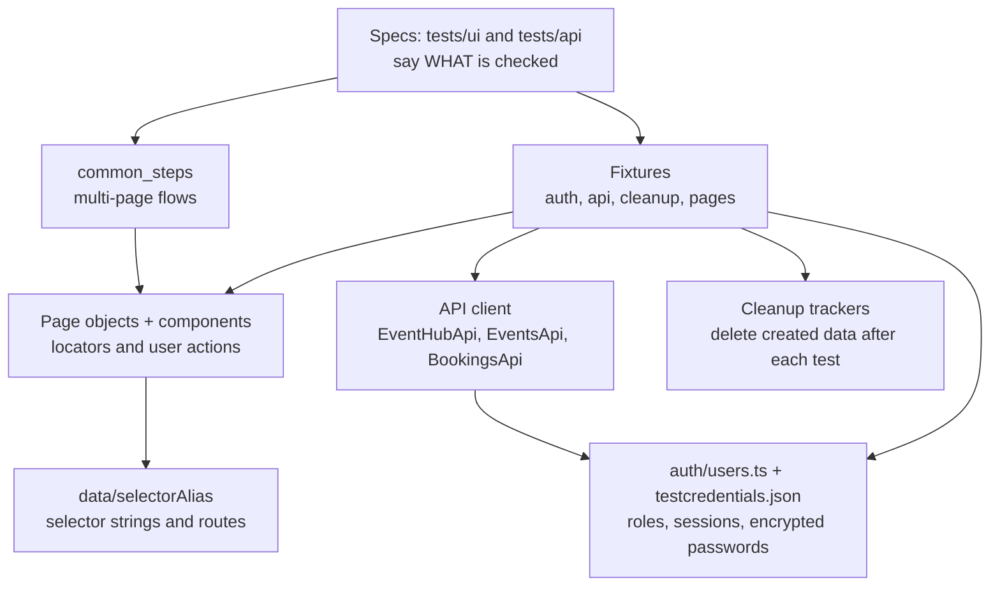

# EventHub QA Automation

Playwright + TypeScript UI and API automation for story **US-114 "Book tickets for an event"** (AC1-AC5) on https://eventhub.rahulshettyacademy.com.

In numbers: **95 tests in 29 files** (UI and API), 4 test accounts, one GitHub Actions workflow. 3 tests are expected failures that document 2 product defects (see [Defects and observations](#defects-and-observations)); everything else is green.

## What the assessment asked for, and where to find it

| The assessment asks for | Where it is answered |
| --- | --- |
| How to run the tests and the credentials needed | [Setup and run](#setup-and-run) and [Credentials for reviewers](#credentials-for-reviewers) |
| A review of the story: what is missing, unclear or wrong, and what to ask the Product Owner | [Story review](#story-review) and [Questions for the Product Owner](#questions-for-the-product-owner) |
| Anything in the app that does not match the story or the docs | [Defects and observations](#defects-and-observations) |
| UI and API automation of the booking flow (AC1 to AC5) | [Coverage by acceptance criterion](#coverage-by-acceptance-criterion) |
| An architecture that can grow over a couple of years | [Architecture](#architecture) and [Structure](#structure) |
| Authorization handled by the framework, not by tests | [Key decisions](#key-decisions), decision 2 |
| Why these tests and not others | [Why these tests](#why-these-tests) |
| Cleaning up data on a shared environment | [Key decisions](#key-decisions), decision 4 |
| Bonus: GitHub Actions on every push | [Key decisions](#key-decisions), decision 9 |
| Key decisions and what I would do with more time | [Key decisions](#key-decisions) and [What I would do with more time](#what-i-would-do-with-more-time) |
| Assumptions where something was unclear | [Assumptions made](#assumptions-made) |
| AI tools: be ready to explain what was submitted | [How AI was used](#how-ai-was-used) |

## Setup and run

```powershell
npm ci
npx playwright install chromium
$env:CREDENTIALS_KEY="<passphrase>"   # decrypts the passwords in data/testcredentials.json (or put CREDENTIALS_KEY=... in .env)
npm test                          # everything (ui + api)
npx playwright test --project=ui
npx playwright test --project=api
npm run test:api                  # api project only
npm run test:xfail                # only the expected failures (known defects)
npm run typecheck
npm run report                    # open the HTML report
```

Optional `.env`: `BASE_URL`, `API_BASE_URL`, `HEADLESS=false`, `SLOW_MO=500` (watch the flow locally).

**Windows PowerShell 5.1:** the console may print `Γ£ô` instead of the check mark in the test list. That is only the console encoding; run `[Console]::OutputEncoding = [System.Text.Encoding]::UTF8` once per session (or use Windows Terminal or PowerShell 7).

**Credentials.** Four throwaway test accounts on the public EventHub site (roles `primaryUser`, `secondaryUser`, `thirdUser`, `fourthUser`) are in [data/testcredentials.json](data/testcredentials.json). The emails are readable; each password is encrypted as `<iv>:<data>:<tag>` (AES-256-GCM, key derived from a passphrase). The passphrase is shared separately, not in the repository.

- **Run the tests:** set the passphrase, then run as usual. The framework decrypts the passwords in memory.
  ```powershell
  $env:CREDENTIALS_KEY="<passphrase>"
  npm test
  ```
- **Decrypt a password** to see it:
  ```powershell
  npm run credentials:decrypt -- "<iv>:<data>:<tag>"
  ```
- **Encrypt a new password** and paste the printed value into the JSON:
  ```powershell
  npm run credentials:encrypt -- "MyPassword1."
  ```
  A password written as plain text also works, and needs no passphrase.
- **CI:** add the passphrase as the repository secret `CREDENTIALS_KEY`.

**Parallel runs.** Each worker runs as its own account (worker 0 = `primaryUser`, worker 1 = `secondaryUser`, ...), so the default is 4 workers, one per account. Use `$env:WORKERS=1` for a serial run. Do not run the `ui` and `api` projects in two terminals at the same time, because they would share the accounts. Tests inside one spec file always run in order. A failed test is retried once; a test that passes on the retry is reported as flaky.

**Expected failures.** Three tests document product defects and are marked `test.fail(...)` with the `@xfail` tag. The report shows them as passed (they fail as expected), so a normal run is green. If one of them starts to really pass, Playwright reports it as a failure, which means the bug was fixed and the marker can be removed. List them with `npm run test:xfail` (or `npx playwright test --grep "@xfail"`; quote it in PowerShell). Each one carries its reason in the report: the HTML report shows a `fail` annotation with the defect description on the test. They are:

| Defect | Test |
| --- | --- |
| 2 Decimal price rounded in the UI | `tests/ui/edgecases/decimalPriceEvent.spec.ts` (2 tests) |
| 3 Fractional seat count (1.5) accepted by the event form | `tests/ui/edgecases/eventFormValidation.spec.ts` (1 test) |

**Tags.** `@ui`, `@api`, `@booking`, `@admin`, `@edge`/`@edgecase`, `@negative`, `@security`, `@xfail`, `@seeded` (tests that use only the seeded events, see decision 13). For example `npx playwright test --grep @security`.

### Credentials for reviewers

The task says to provide the credentials needed to run the tests. The emails are in the repository; the passwords are encrypted in `data/testcredentials.json`. The passphrase for the reviewers is `CREDENTIALS_KEY=xuYoZQnN0y0LRtRqJs7KvjQYvGttVo` (the same value is sent with the submission). A reviewer needs only that one value, as an environment variable or in a `.env` file, to run everything. Reviewers may also replace the accounts with their own: register on the site and put the email and password (plain text works too) in `data/testcredentials.json`.

`npm run cleanup` removes bookings and events left on the test account by an interrupted run.

In CI ([.github/workflows/playwright.yml](.github/workflows/playwright.yml)) the encrypted passwords are decrypted with the `CREDENTIALS_KEY` secret. The HTML report is uploaded as an artifact.

## Story review

Manual test cases are in [docs/test-cases/ui](docs/test-cases/ui) and [docs/test-cases/api](docs/test-cases/api).

### What is wrong, missing or unclear in US-114

| Area | Problem | Question for the Product Owner |
| --- | --- | --- |
| Actor | The story says "visitor", but booking needs a registered, logged-in user (anonymous visitors are sent to login). | Should a guest be able to book, or should the story say "registered user"? |
| AC1 | No limits: minimum and maximum tickets per booking, and what happens when more tickets than seats are requested. | What are the quantity limits, and what message is shown when seats run out? |
| AC1 | No validation rules for name, email and phone (format, length, country code, required or optional). | What is valid for each field, and what are the exact error messages? |
| AC1 | "Confirmation with a booking reference" does not say what the reference looks like. Documented `EVT-XXXXXX`, but the app uses a prefix from the event title (see below). | Which format is correct? Is it unique and permanent? |
| AC1 | Nothing about seats: are available seats reduced after booking, and are they given back after cancellation? Nothing about past or sold-out events. | Can a past or sold-out event be booked? Should the Book button be disabled? |
| AC2 | "Ticket price multiplied by number of tickets" says nothing about currency, rounding, decimal prices, taxes or fees. | How are decimal prices and rounding handled? Are there any fees? Can an event be free (price 0)? |
| AC3 | "Appears in My Bookings" does not say which details are shown, or the order of the list. | Which fields must My Bookings show, and in what order? |
| AC4 | "I can cancel" has no rules: who can cancel, until when, refund, and the status afterwards (is it deleted or marked cancelled?). | Is there a cancellation deadline or refund? Is the booking kept as cancelled? |
| AC5 | Only says "the same works through the API". Missing: authentication, request and response shape, error codes, idempotency (double submit). | What are the required fields, status codes and error format? |
| Whole story | No non-functional criteria: duplicate bookings for the same event, concurrent booking of the last seats, accessibility. | Should one user be able to book the same event twice? |

### Suggested rewrite of the story

A version the team could test without guessing (every sentence maps to a question below):

> **As a** registered, logged-in user **I want to** book 1 to 10 tickets for an upcoming event **so that** I can attend it.
> - AC1: With a quantity between 1 and the seats left (maximum 10), a valid name, email and phone, **Confirm Booking** creates a booking and shows a confirmation with a unique booking reference.
> - AC2: The total is the price per ticket multiplied by the quantity, shown with cents.
> - AC3: The booking is listed in My Bookings with event, date, quantity, total and reference, and the event's available seats are reduced.
> - AC4: The owner can cancel a booking until `<deadline>`; the seats are released and the booking is removed (or marked cancelled).
> - AC5: `POST /api/bookings` with the same rules returns 201 with the booking, 400 for invalid input, 401 without a token, 404 for an unknown event, and nothing is created on an error.
> - Out of scope or to decide: past and sold-out events, duplicate bookings, refunds.

### Assumptions made

- Booking requires login, so the framework logs the test user in by itself (see Key decisions).
- A cancelled booking disappears from My Bookings and gives its seats back; tests check seat counts as a change, not as exact numbers, because the seeded events are shared.
- The booking reference is valid if it matches `/^[A-Z0-9]+-[A-Z0-9]{6}$/`.
- The price shown on the event is the price per ticket in dollars.
- The maximum is 10 tickets per booking and the minimum is 1 (taken from the UI and the API; not stated in the story).
- Behaviour that the story leaves open (past events, decimal prices, fractional seats) is recorded as an expected failure, not as a confirmed bug, until the Product Owner answers.
- The shared site can change while the tests run (other people book the same events). Tests whose result depends on an exact seat count (more tickets than seats, a 20-seat event, the same event twice) create their own event through the API. Tests on the seeded events compare the seats before and after, not absolute numbers.

## Defects and observations

The requirements do not say what is correct for defects 2 and 3 below, so their tests are marked as expected failures (`test.fail(...)` and the `@xfail` tag). The pipeline stays green, the defects stay visible in the report, and a test turns red when its bug is fixed. That is the signal to remove the marker. Run them with `npx playwright test --grep "@xfail"`. Defects 1 and 4 are observations without a test (4 is only observed, ask the Product Owner). Defect 1: a past event cannot be created in the UI or the API (checked by `tests/ui/events/createPastEvent.spec.ts` and `tests/api/events/createPastEvent.spec.ts`), so only the seeded past events can be booked.

| # | Defect | Where | Steps and evidence | Expected | Actual | Tests |
| --- | --- | --- | --- | --- | --- | --- |
| 1 | Past events can be booked | UI and API | Open an event dated in the past (World Tech Summit, 18 Apr 2026) and book it, or `POST /bookings` for it. | Booking is blocked (button disabled or an error). | Booking is confirmed. | No test (observation). Creating a past event is refused, see `tests/ui/events/createPastEvent.spec.ts` and `tests/api/events/createPastEvent.spec.ts` (both pass) |
| 2 | Decimal prices are rounded in the UI | UI only | As admin, create an event with price 12.35 and book 3 tickets. | Price $12.35 and total $37.05 (AC2). | UI shows $12 and a rounded total. The API returns `"12.35"` and `totalPrice` 37.05, so only the UI is wrong. | `tests/ui/edgecases/decimalPriceEvent.spec.ts` (2 tests); the API check is in `tests/api/events/eventPrices.spec.ts` and passes |
| 3 | The event form accepts a fractional seat count | UI | As admin, open "+ New Event", fill the other fields and enter 1.5 in Total Seats. | An inline error, like for 0 or -5. | No inline error is shown. | `tests/ui/edgecases/eventFormValidation.spec.ts` (1 test) |
| 4 | A featured event has a city the city filter does not offer | UI | On the Events page, the demo concert is in "Los Angeles", which is not in the city filter. | Every event can be found with the city filter. | That event cannot be found by city. | No test: observed only. Ask the Product Owner if it is intended |

### Checked and working as expected

- A booking belongs to its owner: another account gets 403 or 404 when it reads or cancels it (`tests/api/edgecases/bookingOwnership.spec.ts`).
- A visitor who is not logged in is redirected to the login page when opening My Bookings (`tests/ui/edgecases/anonymousAccess.spec.ts`).
- A free event (price 0) can be created and booked in the UI and the API, and the total is 0.

### Other findings from exploring the app and API

- **The Swagger "Authorize" button does not work for most endpoints.** On the API docs page you paste a token into "Authorize", but the spec only attaches that token to `/auth/me`. Every other endpoint is called without a token and answers 401. Workaround: add the `Authorization: Bearer <token>` header by hand. The tests always send the header themselves.
- **Booking references do not look like the documented `EVT-XXXXXX`.** Real references start with letters taken from the event title, for example `Q-39FXL1`. The tests therefore accept letters or digits, a dash and 6 letters or digits (`/^[A-Z0-9]+-[A-Z0-9]{6}$/`).
- **Swagger examples return no events.** The sample values pre-filled in the `GET /events` "Try it out" form (category, city, search) match nothing, so the result is an empty list. Clear those fields first.
- **Deleting an event also deletes its bookings.** Customers who booked it lose their bookings silently (`deleteBookedEvent`). This may be intended, but it is worth confirming.
- **Editing an event changes how its bookings look.** A booking shows the event's current title, city and price, so after an admin edit the existing bookings show the new values (`editBookedEvent`).
- The live site has only 3 events and all are in the past, so the booking tests create their own events where they need known data.
- The API returns `price` and `totalPrice` as strings (for example `"12.35"`).
- One user can book the same event more than once. Each booking gets its own reference and takes its own seats (`tests/api/edgecases/bookSameEventTwice.spec.ts`, `tests/ui/edgecases/bookSameEventTwice.spec.ts`). The tests describe the current behaviour; they would need to change if the Product Owner forbids it.
- A booking belongs to its owner: another account gets 403 when it reads it, and 403 or 404 when it cancels it.

## Questions for the Product Owner

The first three come from the defects above. The rest are in the story-review table.

1. **Past events:** should a past event be bookable? If not, should the Book button be disabled, or should the API return an error (and which status code)?
2. **Decimal prices:** should the UI show cents ($12.35 and a total of $37.05), or are whole dollars intended? The backend stores the exact value.
3. **City filter (observation, no test):** should "Los Angeles" be a filter option, or should the demo concert use a city that the filter offers?
4. **Guests:** should a visitor be able to book without an account, or should the story say "registered user"?
5. **Limits and validation:** what are the ticket limits and the rules and error messages for name, email and phone?
6. **Booking reference:** which format is correct, `EVT-XXXXXX` or a prefix from the event title?
7. **Cancellation:** is there a deadline or refund, and is a cancelled booking deleted or kept with a "cancelled" status?
8. **Duplicate bookings:** may one user book the same event more than once? (Today this is allowed in the UI and the API.)
9. **Price 0:** can an event have a price of 0 (a free event)? Today it can be created and booked, and the total is 0. Should free events be allowed, and should they need a different flow (for example no payment step)?

## Architecture



Rules that keep it growing cleanly: specs never contain selectors, URLs, login code or cleanup code; a UI change touches one selector or page-object file; a new endpoint is one method in an API class; a new role is one entry in the credentials file; a new page is one page object, one selector file and one line in `pages.fixture.ts`.

### The layers, from the top

| Layer | What it knows | What it must not know |
| --- | --- | --- |
| **Specs** (`tests/ui`, `tests/api`) | The scenario, the data and the expected result. Written as steps a person can read. | Selectors, URLs, how to log in, how to clean up. |
| **Fixtures** (`fixtures/`) | How to prepare what a test needs: a logged-in page, page objects, an API client, trackers that delete data afterwards. | What a specific test checks. |
| **Common steps** (`common_steps/`) | Flows that cross several pages (open an event, book tickets, check seats on Home, clean up test data). | Locators. They call page objects. |
| **Page objects and components** (`page_objects/`) | What a page offers to a user: `fillName()`, `confirmBooking()`, `bookingCards`. Components (`NavBar`, `EventCard`, `BookingCard`, dialogs) are reused by several pages. | Selector strings. They read them from `data/selectorAlias/`. |
| **Selector aliases** (`data/selectorAlias/`) | The selector strings and routes, one file per page object. | Any behaviour. |
| **API client** (`api/`) | Endpoints, request and response types, paging. `EventsApi` and `BookingsApi` are the two resources; `EventHubApi` joins them and adds account helpers. | UI details. |
| **Config, auth, utils** | URLs and timeouts (`config/env.ts`), accounts and roles (`auth/users.ts`), test data builders and parsing (`utils/`). | Test logic. |

The dependency goes one way only: specs use fixtures, steps and page objects; page objects use selector aliases; nothing below a spec imports a spec. That is why a change stays in one place.

### How a UI test runs

1. The spec imports `test` from `fixtures/index.ts`. That is `mergeTests(cleanupTest, pagesTest)`, so one import gives the test a page, page objects, an API client and the cleanup trackers.
2. The **auth fixture** creates one browser window per spec file and role. It starts from the saved session (`.auth/<role>.json`) when it is still fresh, or logs in once through the real login page and saves it. If the site rejects a saved session, it logs in again by itself. Between tests it only closes extra tabs; it does not reload the page.
3. The **pages fixture** hands out page objects (`homePage`, `eventDetailsPage`, `myBookingsPage`...) that share that page.
4. The test runs its steps through page objects and common steps. Anything it creates is registered with `bookings.track(ref)` or `events.track(title)`.
5. After the test, passed or failed, the **cleanup fixture** deletes the tracked bookings and events through the API. This is faster than clicking in the UI and does not depend on the UI working.

### How an API test runs

API specs import `test` from `fixtures/apiOnly.fixture.ts`. There is no browser. `apiSession.ts` gets a request context for the role, reusing the saved token or calling `POST /auth/login`, and `EventHubApi` wraps it as `api.events` and `api.bookings`. Responses are typed (`api/types.ts`). Prices are strings in the API, so tests compare them as strings. Cleanup works the same way as in UI tests.

### Accounts, roles and parallel runs

- `data/testcredentials.json` holds the accounts. Emails are plain text, passwords are encrypted with AES-256-GCM and decrypted with the `CREDENTIALS_KEY` passphrase.
- A role is a name for an account (`primaryUser`, `secondaryUser`, `anonymous`...). A spec switches role with `test.use({ role: 'secondaryUser' })`.
- Playwright runs 4 workers by default and each worker gets an account in turn, so with enough accounts no two workers share one account's bookings. If there are fewer accounts than workers, some workers share an account. Tests inside one file run in order; files run in parallel.
- The UI and the API are two Playwright projects (`ui`, `api`) in one config, with one report.

### Test data

- Builders in `utils/testData.ts` create unique event titles and valid booking data, so parallel tests do not collide.
- A test that needs an exact seat count creates its own event through the API. Other tests use the seeded events and compare seats before and after their own action (see decisions 5 and 13).
- Cleanup has three layers: the trackers after each test (through the API), `npm run cleanup` for leftovers of an interrupted run, and `cleanUpTestData`, an optional end-of-file step through the UI that clears all bookings of the account.

### Reporting and failures

`list` reporter in the terminal and an HTML report with traces and screenshots kept only for failures. One retry (`retries: 1`) separates flaky tests from real ones; a test that passes only on retry is reported as flaky. Known product bugs are marked `@xfail` with `test.fail(...)` (decision 8).

### CI

`.github/workflows/playwright.yml` installs dependencies, runs the type check, runs the whole suite and uploads the HTML report and traces. It decrypts the passwords with the `CREDENTIALS_KEY` repository secret.

### How to extend it

| I want to add | Where |
| --- | --- |
| A test | A spec in the feature folder under `tests/ui` or `tests/api` (decision 14). |
| A new page | One page object, one file in `data/selectorAlias/`, one line in `pages.fixture.ts`. |
| A new endpoint | One method in `EventsApi` or `BookingsApi` and its type in `api/types.ts`. |
| A new role | One entry in `data/testcredentials.json`. |
| A new capability for every test | A new `*.fixture.ts`, merged in `fixtures/index.ts`. |

## Structure

```text
eventhub-qa-automation/
├── .github/workflows/playwright.yml   CI: type check + run all tests on every push
├── api/                               Typed API client
│   ├── apiSession.ts                    API context per role (reuses saved token or logs in)
│   ├── EventHubApi.ts                   Entry point: `api.events`, `api.bookings`, account helpers (current user, cleanup)
│   ├── EventsApi.ts / BookingsApi.ts    Endpoint groups, called directly by the specs
│   ├── paginate.ts / types.ts           Paging helper and response types
├── auth/users.ts                      Accounts, roles, saved-session paths (.auth/<role>.json)
├── common_steps/                      Reusable multi-page flows (open event, book tickets, check seats)
├── config/env.ts                      URLs, timeouts, headless, CI flag
├── data/
│   ├── testcredentials.json           Test accounts (emails plain, passwords encrypted)
│   └── selectorAlias/                 Selector strings and routes, one file per page object
├── docs/test-cases/                   Manual test cases: ui/ (bookings, booking-details, cancellation, edge-cases, events) and api/ (bookings, cancellation, edge-cases, events)
├── fixtures/
│   ├── index.ts                       Entry point for UI specs (test, expect, cleanUpTestData)
│   ├── auth.fixture.ts                Logged-in page per worker account, session reuse
│   ├── apiOnly.fixture.ts             API-only tests (no browser)
│   ├── api.fixture.ts                 API client inside UI tests
│   ├── cleanup.fixture.ts             Tracks created bookings/events and deletes them through the API
│   └── pages.fixture.ts               Page objects as fixtures
├── page_objects/                      Locators and actions per page
│   ├── components/                      NavBar, EventCard, BookingCard, dialogs, messages
│   └── admin/                           Manage Events / admin bookings
├── scripts/
│   ├── cleanup.spec.ts                `npm run cleanup`: removes data left by an interrupted run
│   └── credentials.ts                 `credentials:encrypt` / `credentials:decrypt` command line
├── tests/
│   ├── api/                           API project (same feature folders as the UI project)
│   │   ├── booking/                     create a booking: confirmation, total, seats, bookings list
│   │   ├── cancellation/                cancel a booking: seats restored, 404 afterwards
│   │   ├── events/                      create / edit / delete an event that is booked, past date refused, decimal and free price
│   │   └── edgecases/                   booking and event validation, 401 without a token, ownership (security), same event twice
│   └── ui/                            UI project
│       ├── booking/                     happy paths: book from Home or Events, many tickets, booking details
│       ├── cancellation/                happy paths: cancel from My Bookings or details, clear all
│       ├── events/                      admin event management (create, edit, delete, past date refused) and Events page consistency
│       └── edgecases/                   limits, validation, security, same event twice, decimal and free price
├── utils/                             Test data builders, parsing, dates, selector helpers
├── playwright.config.ts               Projects (ui, api), workers, retries, reporters
└── cleanup.config.ts                  Playwright config for the cleanup script
```

| Folder | Purpose |
| --- | --- |
| `tests/ui`, `tests/api` | Specs, one Playwright project each |
| `page_objects/` | Locators and user actions per page and component |
| `data/selectorAlias/` | Selector strings and routes, one file per page object |
| `common_steps/` | Reusable multi-page flows (open event, book tickets...) |
| `api/` | Typed API client: `EventsApi`, `BookingsApi`, `EventHubApi` entry point: `api.events`, `api.bookings`, account helpers |
| `fixtures/` | Auth, API, cleanup and page fixtures |
| `config/`, `auth/`, `utils/` | Environment, accounts, test data builders |

## Coverage by acceptance criterion

| AC | UI | API |
| --- | --- | --- |
| AC1 create booking and confirmation | `booking/bookFeaturedEventTicket`, `bookFromEventsPage`, `bookMultipleTickets`, `verifyBookingDetails`; `edgecases/bookingFormValidation`, `ticketQuantity`, `bookSameEventTwice`; `edgecases/anonymousAccess` | `createBooking`, `createBookingValidation`, `events/bookNewEvent`, `bookSameEventTwice` |
| AC2 total price | `bookMultipleTickets` (2, 4, 10 tickets), `edgecases/freeEvent` (price 0), `decimalPriceEvent` (xfail, UI rounds cents) | `createBooking` (price x quantity), `events/eventPrices` (decimal and free) |
| AC3 booking in My Bookings | `bookMultipleTickets`, `verifyBookingDetails`, `bookSameEventTwice`, `cancellation/*` | `createBooking` (listed in `GET /bookings`), `bookingOwnership` (not listed for other users) |
| AC4 cancel | `cancellation/cancelFeaturedEventBooking`, `cancelFromBookingDetails`, `clearAllBookings` | `cancelBooking`, `bookingOwnership` (others cannot cancel) |
| AC5 same through the API | - | all of `tests/api` (`POST /bookings`, validation, auth, seats, ownership) |
| Beyond the story | `events/createEvent`, `editEvent`, `deleteEvent`; `edgecases/eventFormValidation` | `events/editBookedEvent`, `deleteBookedEvent`, `edgecases/createEventValidation` |

### Why these tests

- **Every AC has a UI test and an API test.** That is what the story asks for (AC5 says the same must work through the API), and it shows whether the UI and the backend agree. The decimal price case is the example: the API test proves the backend is correct, so the UI test points at the front end.
- **Depth goes where the risk is.** Money (total price, decimals, free events), limits (1 to 10 tickets, seats left, more tickets than seats), input validation (name, email, phone, empty form), data integrity (seats released on cancel, what happens when an event is edited or deleted), and access control (no token, another user's booking, not logged in).
- **Negative and boundary cases are API-first.** They are fast and exact there (0, -1, 11 tickets, missing field, unknown event). The UI covers the same rules once, through the form, because that is what a user sees.
- **Admin event tests exist because they are test data and a risk.** Events can be created, edited and deleted in the UI, which changes what bookings show. Booking tests need known events, and the shared site has only 3 events, all in the past.

The manual test cases behind these are in [docs/test-cases/ui](docs/test-cases/ui) and [docs/test-cases/api](docs/test-cases/api).

### UI tests and their API counterparts

The same rule is checked twice on purpose. The API test is fast and exact, so it proves what the backend does. The UI test proves that the screen shows and sends the same thing. When the two disagree, the table tells you where the bug is (the decimal price is the example: API passes, UI fails, so the front end is wrong).

| Topic | UI test (what the user sees) | API test (what the backend does) | Why both, and what the pair tells us |
| --- | --- | --- | --- |
| Create a booking (AC1, AC5) | `booking/bookFeaturedEventTicket` (Concert, Conference, Festival from Home) and `booking/bookFromEventsPage` (filter by category, then book). Fill name, email and phone, click Confirm Booking; the confirmation shows a reference, the customer, the tickets and the total. | `createBooking`: one test books 2 tickets for every seeded event. `POST /bookings` returns `status` "confirmed", the same `eventId`, `quantity` and customer, and a reference matching `/^[A-Z0-9]+-[A-Z0-9]{6}$/`. | The UI proves the form and the confirmation screen work from two entry points. The API proves the booking is really stored with the right data. If the UI passes and the API fails, the screen shows a confirmation for something that was not saved. |
| Total price (AC2) | `booking/bookMultipleTickets` with 2, 4 and 10 tickets: the summary line, the total and the confirmation all equal price x quantity. | `createBooking`: one test books 2 tickets for every seeded event and checks `totalPrice` = price x 2 for each, plus the booking in `GET /bookings`. | The API checks the number that is charged. The UI checks that the user is shown the same number. |
| Booking in My Bookings (AC3) | `bookMultipleTickets`, `verifyBookingDetails` and `bookSameEventTwice`: the card with the reference is in My Bookings with the event title, tickets and total. The details page shows the header, customer and payment blocks. | `createBooking`: "every listed event can be booked: confirmation, total price and bookings list are correct" (`GET /bookings` and the lookup by reference, with the embedded event); `bookSameEventTwice`. | The API proves the data exists and is linked to the right event. The UI proves it is displayed correctly. The details page has no API counterpart beyond the embedded event, because it only formats that data. |
| Seats go down | `bookMultipleTickets` reads the seats on the event page before and after booking. | `createBooking`: the same one test checks that the seats go down by the booked quantity for every seeded event; `createBookingValidation`: 10 tickets leave 10 of 20 seats. | The API check compares before and after on shared seeded events, so another worker booking the same event at that moment could disturb it, while `createBookingValidation` owns its event and is exact. The UI check compares before and after on shared events, so it can be disturbed by other users; its failure message says so. |
| Cancel a booking (AC4) | `cancellation/cancelFeaturedEventBooking` (dialog, dismiss, confirm) and `cancelFromBookingDetails`: the card disappears and the seats on Home return to the earlier value. | `cancelBooking`: one test books 2 tickets on every seeded event, then `DELETE /bookings/{id}` returns 200, seats are restored, the booking is gone from the list, `GET` returns 404, and cancelling twice returns 404. | The UI covers the dialog and the click path. The API covers the rules a user cannot reach by clicking (a second cancel, fetching a cancelled booking). |
| Clear all bookings | `cancellation/clearAllBookings`: three bookings are listed, then cleared and stay gone after a reload. | None. | UI feature only. Clearing all bookings has no step in the story, so it is not repeated through the API. |
| Ticket quantity limits | `edgecases/ticketQuantity`: starts at 1, minus is disabled at 1, plus stops at 10, and stops at the seats left when fewer than 10 remain. | `createBookingValidation`: quantity 0, -1 and 11 return 400; 10 is accepted; 3 tickets on a 2-seat event return 400 and the seats stay at 2. | The UI stops a user at the limit with the buttons. The API proves the server enforces the limit even when the screen is bypassed. |
| Form validation | `edgecases/bookingFormValidation`: empty form shows three errors; name ("A", spaces only), email (four bad formats) and phone (9 digits, letters) are rejected; a valid form is accepted. | `createBookingValidation`: a missing `customerEmail`, the four bad emails and two bad phones return 400 and take no seats. | The UI shows the error messages. The API proves the server rejects the same input. The name rules are only covered in the UI, because the API does not define them (see the questions for the Product Owner). |
| Not logged in or not the owner (security) | `edgecases/anonymousAccess`: a visitor opening `/bookings` is sent to the login page. | `createBookingValidation`: no `Authorization` header returns 401. `bookingOwnership`: another account gets 403 or 404 when it reads or cancels my booking and does not see it in its list. | UI: nobody lands on a page without a session. API: the server refuses the request even if someone calls it directly. Ownership is checked only in the API, because the UI cannot open another user's booking by design. |
| Past event cannot be created | `events/createPastEvent`: the admin form shows "Must be a future date" and the number of events does not change. | `events/createPastEvent`: `POST /events` with a past date returns 400 about `eventDate` and creates nothing. | Both layers refuse a past date. The UI shows the message, the API proves the server enforces the rule. |
| Decimal price (defect 2) | `edgecases/decimalPriceEvent` (`@xfail`, 2 tests): an event with price 12.35 shows $12 and a rounded total. | `events/eventPrices`: the event is returned with `"12.35"` and `totalPrice` 37.05 for 3 tickets. Passes. | The API passes and the UI fails, so the rounding is a front-end defect. This is the clearest case for having both layers. |
| Free event (price 0) | `edgecases/freeEvent`: create an event with price 0, check it shows `$0`, book 2 tickets with total `$0`. | `events/eventPrices`: price 0 is stored, the booking is confirmed with `totalPrice` 0, and the seats drop by 2. | The API proves the backend accepts 0. The UI proves the price and the total are shown and the form can be submitted. |
| Same event twice | `edgecases/bookSameEventTwice`: two bookings on one event, both in My Bookings with different references. | `edgecases/bookSameEventTwice`: two different ids and references, both listed, seats reduced by 4. | Documents current behaviour (the story is silent). Both layers agree. |
| Events created and changed by an admin | `events/createEvent`, `events/editEvent`, `events/deleteEvent`, `edgecases/eventFormValidation`: the admin screens (the form, the table, the dialogs). | `events/bookNewEvent`, `editBookedEvent`, `deleteBookedEvent`: what happens to bookings when their event is created, edited or deleted (the list shows the new values, a delete removes the bookings). | The UI tests cover the admin screens. The API tests cover the data effect on bookings, which the admin screens do not show. |
| Events page filter and demo data (defect 4) | None: observed only, to be confirmed with the Product Owner. | None. | UI only. It is a display and data consistency issue, not a rule of the booking API. |

## Key decisions

1. **Playwright + TypeScript for both UI and API.** One language, one runner, one report and one fixture system. The API client reuses the same auth and cleanup code as the UI tests, so a RestAssured project would only have duplicated it.
2. **Authorization lives in the framework.** The `auth` fixture gives every test a page that is already logged in. It saves the session per role (`.auth/<role>.json`), reuses it while it is fresh, and logs in again by itself if the site rejects it. API tests get a client that reuses the saved token or calls `POST /auth/login`. No spec contains login code. Changing role is one line: `test.use({ role: 'secondaryUser' })`.
3. **Layers with one job each.** Specs say what is checked; page objects hold locators and user actions; `data/selectorAlias` holds the selector strings; `common_steps` holds multi-page flows; `api/` is a typed client (`EventsApi`, `BookingsApi`, `EventHubApi` entry point: `api.events`, `api.bookings`, account helpers); `fixtures/` wire everything together. A UI change touches one file, and a new test is mostly composition.
4. **Test data is cleaned up by the framework.** Tests call `bookings.track(ref)` or `events.track(title)`; after each test, passed or failed, the tracked data is deleted through the API. `npm run cleanup` removes leftovers from an interrupted run. Tests do not need an `afterEach`.
5. **Own data where the result must be exact, before-and-after checks on shared data.** Other people use the same site, so seat counts of the seeded events can change during a run. Tests that need an exact count create their own event through the API: the 2-seat over-booking test, the 20-seat tests (`bookNewEvent`, `editBookedEvent`, same event twice), the price tests, ownership, and the past-event tests. The remaining booking and cancellation tests use the seeded events and compare the seats before and after (for example 10 seats before, 8 after booking 2), and their failure message points at concurrent activity. Making every test create its own event is listed under "What I would do with more time".
6. **One account per worker.** Booking data belongs to an account, so two workers on one account would delete each other's bookings (for example `Clear all bookings`). One account per worker keeps parallel runs safe.
7. **What is covered and why.** Every AC has UI and API coverage. Extra depth goes where the risk is: price calculation, ticket limits (1 to 10 and seats left), form validation, seat release on cancellation, over-booking, missing token, and what happens to bookings when their event is edited or deleted. Cosmetic checks and cross-browser runs were left out to keep the suite fast and stable.
8. **Known product bugs are expected failures (`@xfail`), not skipped and not deleted.** The test keeps its real assertion (the correct behaviour) and is wrapped in `test.fail(...)`. The bug stays visible and documented, the pipeline stays green so a real regression is not hidden among known failures, and the test turns red by itself when the bug is fixed. A comment in each test says what is unclear and what the Product Owner has to decide.
9. **CI.** GitHub Actions ([.github/workflows/playwright.yml](.github/workflows/playwright.yml)) runs on every push, pull request and manual start: install, type check, run the whole suite, upload the HTML report and traces (14 days). The passwords are decrypted with the `CREDENTIALS_KEY` repository secret. One retry separates flaky tests from real failures.
10. **Encrypted passwords in the repository.** Test accounts are needed to run the tests, but a public repository should not expose passwords. They are encrypted with AES-256-GCM and a key derived from a passphrase, so reviewers need one secret instead of four passwords and rotating a password is a command, not a code change.
11. **Type safety and the type check in CI.** TypeScript strict mode plus typed API responses catch wrong field names and the string-versus-number price at compile time, before a test runs.
12. **Explicit, readable tests.** A test reads as the user flow with named steps (`test.step`), so a failed run in the report says which step broke. Shared logic is in page objects, steps and fixtures, not in helpers hidden in the specs.
13. **Tests do not depend on each other.** Each test sets up its own data and cleans it up, so they can run in any order and in parallel across accounts. Files that build state step by step (the event form validation) say so in their header.

    **Shared data and seeded events.** The events list (`GET /events`) is global: all workers see the same list. *Seeded* events are the ones that exist on the site before any test runs (`isStatic: true` in the API); they are never deleted. *Temporary* events are created by admin tests and deleted by their cleanup at the end of that test. Cleanup guarantees that an event is removed, but it cannot know that another worker already read the list and still plans to use that event. Example: worker 1 creates event X; worker 2 reads the list, which includes X; worker 1 finishes and deletes X; worker 2 reaches X and `POST /bookings` returns 404. That was a rare flaky failure that the retry hid. The tests that loop over the whole list or pick an event from it (`booking/createBooking`, `cancellation/cancelBooking`) therefore keep only seeded events: `(await api.events.listEvents()).filter((e) => e.isStatic)`. Nothing can delete a seeded event during the run, so the 404 cannot happen. These tests carry the `@seeded` tag (`npx playwright test --grep @seeded`). Coverage is unchanged for the purpose of the loop (every normal event can be booked and cancelled); only temporary events are left out.
14. **One rule for where a spec goes.** Folders under `tests/api` and `tests/ui` are named after the feature, never after a role: `booking/` and `cancellation/` hold the happy path of that feature, `edgecases/` holds limits, validation, security, defects and unusual data, and `events/` holds event management. The same names exist in both projects, so the UI and API test of one rule are easy to find side by side. A new spec goes in the folder that matches its main purpose; do not create a new folder unless a new feature needs one.
15. **Specs call the resource clients directly.** Tests use `api.events.createEvent(...)` and `api.bookings.createBooking(...)`. `EventHubApi` only adds what spans both resources or the account (`currentUserId`, `cleanupAccount`), so a new endpoint is added in one place and there is no second list of forwarding methods to keep in sync.

## What I would do with more time

1. **More accounts or CI sharding.** Parallelism is limited by the number of accounts (4 now, one per worker). More accounts, or one account per shard, would shorten the run.
2. **A `bookableEvent` fixture, and no more `@seeded` tests.** The race with deleted temporary events is fixed by using only seeded events (decision 13), but seeded events are still shared: several workers can book the same one at the same time, so those tests only compare seats before and after their own booking. A fixture that creates a dedicated event with known seats for each booking test would make the counts exact and remove the need for the `@seeded` tag. It is not done now because the story is about booking the events users actually see, and the seeded events are those events.
3. **Cross-browser runs.** Add Firefox and WebKit projects once the suite is stable on Chromium.
4. **Visual and accessibility checks.** Screenshot comparison of the booking form and confirmation, and axe checks on the booking flow.
5. **Flaky-test reporting.** Keep a trend of retried tests across CI runs so flakiness is seen before it becomes a problem.
6. **More security and concurrency tests.** Cross-user access is covered (`bookingOwnership`). Still open: book the last seats from two sessions at once (two users book the last free seat at the same moment; exactly one must succeed and the seat count must never go below 0, otherwise the event is overbooked), test token expiry (an expired token must get 401, so an old session cannot keep access), and a tampered token (a token with a changed payload or signature must get 401 or 403, so nobody can pretend to be another user).
7. **Resolve the open product questions.** Several expected results (quantity limits, rounding, cancellation rules, reference format, past events, duplicate bookings) are assumptions until the Product Owner answers the questions above. Then each `@xfail` test is either fixed in the app or changed to the agreed behaviour.

## How AI was used

AI tools (GitHub Copilot in VS Code) helped with exploring the site and the API, drafting the framework code and the README, and reviewing it. Every decision above was checked by running the tests against the live site, and I can explain each file: why the layers are split this way, how the session reuse and the per-worker accounts work, how the cleanup trackers delete data, why prices are compared as strings in the API tests, and why some tests are `@xfail`. The defects in this README were reproduced by hand or by a test before being written down; a suspected problem that could not be reproduced (a quick-filter issue on the Events page) was left out.

